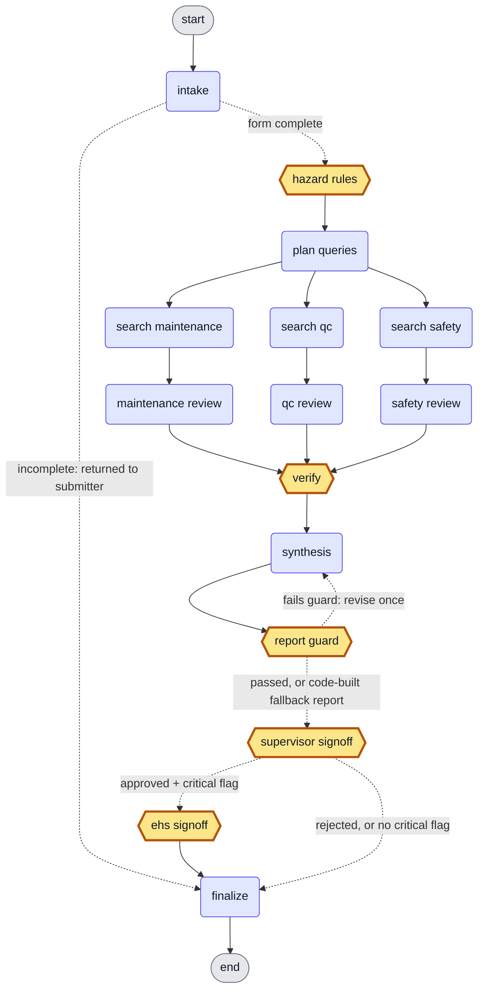

# process_review — graph

Generated by `make graph FLOW=process_review` from the compiled LangGraph graph, so it matches the
code. Yellow hexagons are gates, where a code check or a person must say yes. Dotted arrows
are routing decisions, labelled with the condition; solid arrows always run.

## Gates (highlighted)

| node | what must say yes |
|---|---|
| `hazard_rules` | incompatible pairs, chemical limits, equipment ratings: locked flags, never removed |
| `verify` | every flag cites a current document passage it quotes exactly; uncovered items become gaps |
| `report_guard` | no approval language, grounded numbers, recommendation no softer than the flags |
| `supervisor_signoff` | the floor supervisor approves the exact report digest |
| `ehs_signoff` | a process-safety / EHS engineer also approves when any flag is critical |
